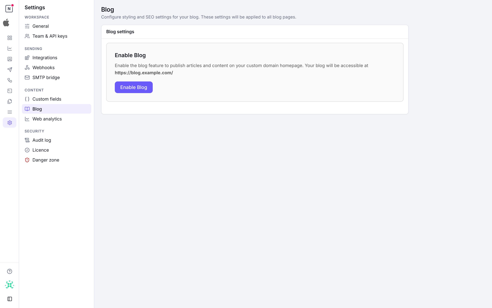
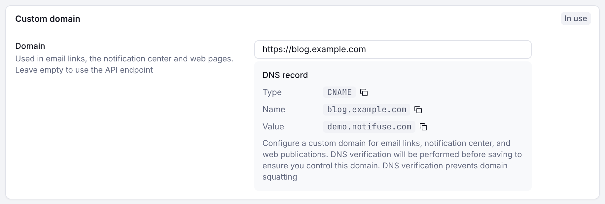

## Enabling the Blog

1. Set the blog's domain in **Settings** > **General**, in the **Custom domain** panel (see [Custom Domain](#custom-domain)). The blog cannot be enabled without one.
2. Go to **Settings** > **Blog**
3. Click **Enable Blog**
4. A default theme is automatically created and published

## Custom Domain

The blog is served at the root path `/` of your custom domain. Configure this in **Settings → General**, in the **Custom domain** panel:

1. Set the **Domain** (e.g., `https://blog.example.com`)
2. Point your DNS to your Notifuse instance
3. The blog will be available at `https://blog.example.com/`

When the blog is disabled, the root path redirects to `/console`.



## URL Structure

```
https://blog.example.com/                     → Home page
https://blog.example.com/?page=2              → Home page 2
https://blog.example.com/announcements        → Category page
https://blog.example.com/announcements/hello  → Post page
```

## Blog Settings

| Setting | Description |
|---------|-------------|
| **Title** | Blog title (defaults to workspace name) |
| **Logo URL** | Blog-specific logo |
| **Icon URL** | Favicon for the blog |
| **Home Page Size** | Posts per page on home (default: 20, max: 100) |
| **Category Page Size** | Posts per page on categories (default: 20, max: 100) |

## SEO Settings

Default SEO settings apply to all pages unless overridden at the category or post level:

| Field | Description |
|-------|-------------|
| **Meta Title** | Title tag for search engines |
| **Meta Description** | Description for search results |
| **OG Title** | Open Graph title for social sharing |
| **OG Description** | Open Graph description |
| **OG Image** | Image for social sharing |
| **Keywords** | Meta keywords |
| **Meta Robots** | Crawling directives (e.g., `index,follow`) |
| **Canonical URL** | Canonical URL override |

## Auto-Generated Pages

The blog automatically generates:

- **`/robots.txt`** - Allows all crawlers and references the sitemap
- **`/sitemap.xml`** - Lists all published posts with last modified dates

## Caching

Blog pages are cached for 5 minutes. Cache is automatically cleared when:

- A post is published or unpublished
- A post is created, updated, or deleted
- A theme is published
- A category is modified
