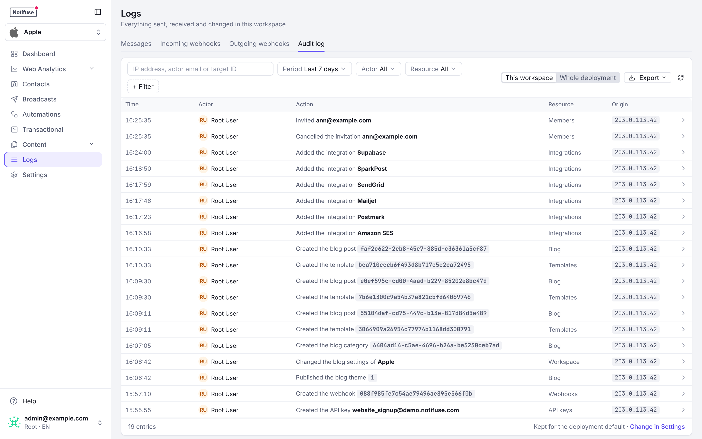
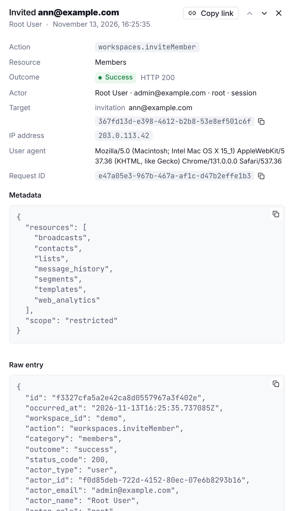

## Overview

The audit log records every control-plane action taken on a deployment: a member invited, a permission set changed, an API key created, an integration edited, a template saved, a broadcast scheduled, a contact deleted, the licence installed. Each entry names the actor, the action, what it was done to, the IP address and user agent it came from, the request id, and whether it succeeded, failed or was refused. The security-sensitive actions also carry a before/after of what changed, with every secret redacted.

It never records the data plane — contact upserts, sends, tracking, custom events — which can run at thousands of requests a minute and belongs in [Logs](/features/logs), not in a trail.

Audit logs are a **licensed capability** (Enterprise): recording happens only while a licence key covering `audit_logs` is installed. Reading, exporting and configuring the retention are never gated, so the page works in every licence state on whatever was recorded. See [Licence keys](/self-hosting/licence).

On Notifuse Cloud the key is managed for you, and audit logs are recorded on the Business plan. See [On Notifuse Cloud, including instances still on their earlier terms](/self-hosting/licence#on-notifuse-cloud).

<Note>
  **Nothing is refused, nothing is hidden.** An unlicensed deployment writes no entries and is told nothing; a deployment whose key lapses stops recording after the 30-day grace period and writes one marker entry, `licence.recordingStopped`, so the gap is never silent. Installing a key again writes `licence.recordingResumed`.
</Note>

## Where to find it

**Logs → Audit log** in a workspace shows that workspace's entries, next to the message and webhook logs. A root user (a `ROOT_EMAIL`) can switch the same tab to **Whole deployment**: every workspace plus the deployment-level entries that belong to no workspace — sign-ins, the licence, the system settings.

Owners always see the tab. A member or an API key sees it only when granted the **Audit logs** read permission, which is an opt-in grant: it is never part of "full access", because full access should not imply reading every colleague's email address, IP address and refused actions. A member with that permission alone sees the Logs menu entry and only this tab.

Each entry reads as a sentence, such as "Invited **ann@example.com**", next to the actor, the resource and, when the request did not succeed, its outcome. Clicking an entry opens it in a side panel with the action, the outcome and HTTP status, the actor, the target, the IP address, the user agent, the request id, the before/after of what changed, the metadata and the raw entry.

**Settings → Audit log** is where an owner sets the workspace's retention, and where the licence notice appears when nothing is being recorded.

## What an entry contains

| Field | Meaning |
|---|---|
| `occurred_at` | When the action completed, UTC. |
| `action` | The RPC route that performed it, verbatim: `workspaces.inviteMember`, `templates.update`, `contacts.delete`. |
| `category` | A grouping for filtering: `auth`, `licence`, `system`, `workspaces`, `members`, `api_keys`, `integrations`, `webhooks`, `templates`, `broadcasts`, `automations`, `lists`, `segments`, `transactional`, `blog`, `contacts`, `audit`. |
| `outcome` | `success`, `failure` (the request was refused for another reason, or a login failed) or `denied` (403 or 402). |
| `status_code` | The HTTP status the request answered with. |
| `actor_type`, `actor_id`, `actor_email`, `actor_name`, `actor_role` | Who did it: a `user`, an `api_key`, the `system` (retention purges, licence markers) or `anonymous` (a failed sign-in). The role is `owner`, `member` or `root`. |
| `auth_method` | `session`, `api_key`, `magic_code`, `sso` or `root_password`. |
| `target_type`, `target_id`, `target_name` | What it was done to. |
| `ip_address`, `user_agent`, `request_id` | Where it came from. The request id is echoed on every API response as `X-Request-ID`, so an entry can be tied back to an application log line. |
| `changes` | Before/after of the fields that changed, as `{ "field": { "old": …, "new": … } }`. Passwords, secrets, tokens and keys are replaced by `[redacted]` on both sides; the fact that they changed is kept. |
| `metadata` | Free-form detail: the permission scope granted, the number of contacts imported, the reason a sign-in failed. |

## What is recorded

Every `POST /api/…` route below is recorded under its own name. Reads are not recorded, with one exception: the console's contact export asks for the first page of `contacts.list` with `export=true`, and that request is recorded as `contacts.export`. An API client paging the list on its own is a read like any other and is not.

| Category | Actions |
|---|---|
| auth | `user.signin`, `user.verify`, `user.rootSignin`, `user.oidc.exchange`, `user.oidc.callback`, `user.logout`, `setup.initialize` |
| licence | `licence.set`, `licence.recordingStopped`, `licence.recordingResumed` |
| system | `settings.update` |
| workspaces | `workspaces.create`, `workspaces.update`, `workspaces.delete`, `workspaces.setBlogSettings`, `workspaces.setCustomFieldLabels`, `workspaces.setWebAnalyticsSettings`, `workspaces.setAuditLogSettings` |
| members | `workspaces.inviteMember`, `workspaces.acceptInvitation`, `workspaces.joinInvitation`, `workspaces.deleteInvitation`, `workspaces.removeMember`, `workspaces.setUserPermissions` |
| api_keys | `workspaces.createAPIKey`, `workspaces.connectZapier` |
| integrations | `workspaces.createIntegration`, `workspaces.updateIntegration`, `workspaces.deleteIntegration`, `ses.enableTenantIsolation`, `webhooks.register` |
| webhooks | `webhookSubscriptions.create`, `.update`, `.delete`, `.toggle`, `.regenerateSecret` |
| templates | `templates.create`, `.update`, `.delete`, `templateBlocks.create`, `.update`, `.delete` |
| broadcasts | `broadcasts.create`, `.update`, `.schedule`, `.pause`, `.resume`, `.cancel`, `.delete`, `.retryFailed`, `.selectWinner`, `.sendToIndividual` |
| automations | `automations.create`, `.update`, `.delete`, `.activate`, `.pause` |
| lists, segments | `lists.create`, `.update`, `.delete`, `segments.create`, `.update`, `.delete`, `.rebuild` |
| transactional | `transactional.create`, `.update`, `.delete` |
| blog | `blogPosts.*`, `blogCategories.*`, `blogThemes.*` |
| contacts | `contacts.delete`, `contacts.import`, `contacts.export`, `customEvents.import`, `annotations.*`, `webAnalytics.backfillStart`, `.backfillCancel` |
| audit | `auditLogs.export`, `audit.purged` |

`GET /api/auditLogs.actions` returns this catalogue, which is what the console's action filter is built from.

**Failures are recorded too.** A sign-in for an unknown address, a wrong or expired code, a rate-limited attempt: the response gives nothing away, and the entry says why (`metadata.reason`). A request refused by a permission check is recorded as `denied` with the resource and permission it lacked; one refused by the licence is `denied` with the feature it needed.

**Not recorded**: the data plane (`contacts.upsert`, `customEvents.upsert`, `transactional.send`, `lists.subscribe` and the other per-contact routes), reads, tests and previews, the internal task endpoints, and a broadcast paused automatically by the circuit breaker — that runs on the send path, which contains no licence check of any kind.

## Filtering and export

The search box takes an IP address, an actor email or a target id, and says which one it is searching by: an IP address and a target id must match exactly, an email matches any part of it. Next to it, filters for the period (the last 24 hours to the last 90 days, all time, or a custom range), the actor (yourself, a member or one key in the workspace view; any API key, the system or a signed-out visitor in both views) and the resource, and **+ Filter** for the action, the outcome, the actor email, the target id and the IP address. Every filter is kept in the page's link, so a filtered view can be shared or bookmarked. The API accepts the same filters plus `target_type`. Pages are cursor-based, newest first, and in the workspace view the foot of the list shows how long the workspace keeps its entries.

**Export** downloads the current filter as CSV or NDJSON, up to 100 000 rows; an export that hits the cap ends with an `export.truncated` marker row carrying `max_rows`, so a truncated file never passes for a complete one — narrow the date range and export again. The export is itself recorded as `auditLogs.export`. Every entry carries an id, and the side panel has a **Copy link** button: the link opens the page on that entry, even when it is far down the list.

## Retention

Entries older than the retention are deleted once a day. The default is **365 days**; a workspace owner can set the workspace's own retention in Settings → Audit log (0 keeps every entry forever, otherwise 30 to 3650 days), and a root user sets the deployment default — which also governs deployment-level entries and the entries of workspaces that no longer exist — in the system settings. Each purge that removed something is recorded as `audit.purged`, with the count.

The retention runs in every licence state: deleting data never depends on the licence.

## Integrity

The table is **append-only**: a database trigger refuses every `UPDATE` and `TRUNCATE`, and every `DELETE` except the ones the retention function performs. No code path in Notifuse rewrites history, and neither does a stray SQL statement run through its database role.

What it does not stop: the owner of the database, or a superuser, who can disable the trigger or drop the table. The guarantee is "the application cannot alter the log", not "nobody can". If you need to prove that to an auditor, back the table up out of band on a schedule they accept.

Entries are stored in the system database, not in the workspace's own database, so deleting a workspace deletes nothing from the log: the record of who deleted it, and of what they did before, survives.

## API

The four endpoints are documented in the API reference: [`auditLogs.list`](/api-reference/audit-logs/list-audit-logs), [`auditLogs.get`](/api-reference/audit-logs/get-an-audit-log-entry), [`auditLogs.actions`](/api-reference/audit-logs/list-audit-actions) and [`auditLogs.export`](/api-reference/audit-logs/export-audit-logs). An API key can call them when granted the Audit logs read permission, which is how a SIEM pulls the log on a schedule. The retention is set over the API with [`workspaces.setAuditLogSettings`](/api-reference/audit-logs/set-the-workspace-audit-log-retention), which only a workspace owner can call — no permission grants it.
