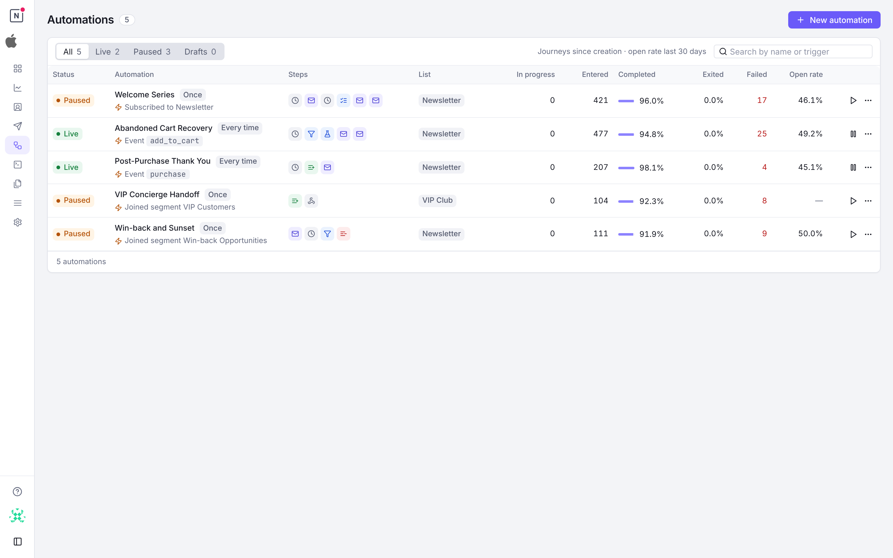
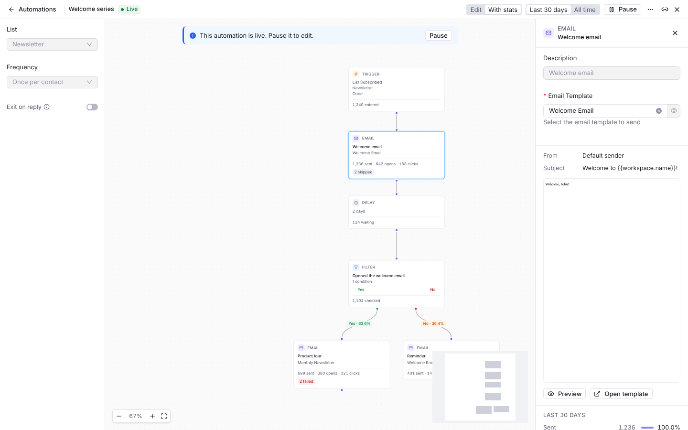
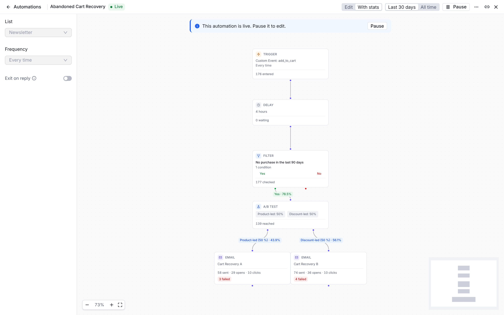

Marketing automations let you create event-driven workflows that automatically engage contacts based on their behavior and lifecycle events. Instead of manually sending emails, automations trigger actions when specific events occur—like a contact subscribing to a list, opening an email, or completing a custom event.

**Key Benefits:**
- **Automated nurturing**: Welcome sequences, onboarding flows, re-engagement campaigns
- **Triggered emails**: Send the right message at the right moment based on contact actions
- **Behavioral responses**: React to email opens, clicks, bounces, and custom events

## Automation Lifecycle

Automations have three states that control their behavior:

| Status | Description |
|--------|-------------|
| **Draft** | Building and testing mode. No contacts are enrolled. |
| **Live** | Active automation. Contacts are enrolled when trigger events occur. |
| **Paused** | Stops new enrollments. In-progress journeys continue to completion. |

**Workflow:**
1. Create automation in **Draft** mode
2. Configure trigger and add nodes
3. **Activate** to go live and start enrolling contacts
4. **Pause** when needed—active contacts continue their journey
5. **Delete** performs soft-delete with recovery capability

### The automations list

The **Automations** page lists every automation with its status, its trigger, its steps and its list. Tabs keep the live, paused or draft ones, and the search finds an automation by its name or by its trigger (a list, a segment, a custom event name, a clicked link). Each row gives the journeys since the automation was created: in progress, entered, the share of finished journeys that completed and that exited, and the number that failed. The open rate is that of its emails over the last 30 days, and needs the **Message history** read permission.

Activate or pause an automation from its row; edit or delete it while it is not live. A click on a row opens the automation in its editor, with its results when it has run.

## Triggers

Triggers define when contacts enter an automation. They're based on events that appear in the contact timeline.

### Trigger Frequency

| Frequency | Behavior |
|-----------|----------|
| `once` | Contact enters only on the first occurrence of the event |
| `every_time` | Contact can re-enter each time the event occurs |

### Event Types

Automations can trigger on any of these timeline events:

#### Contact Events

| Event | Description |
|-------|-------------|
| `contact.created` | New contact added to workspace |
| `contact.updated` | Contact fields modified |
| `contact.deleted` | Contact removed from workspace |

#### List Events

| Event | Description |
|-------|-------------|
| `list.subscribed` | Contact subscribed to a list |
| `list.unsubscribed` | Contact unsubscribed from a list |
| `list.confirmed` | Contact confirmed subscription (double opt-in) |
| `list.resubscribed` | Previously unsubscribed contact resubscribed |
| `list.bounced` | Email to contact bounced |
| `list.complained` | Contact marked email as spam |
| `list.pending` | Contact in pending confirmation state |
| `list.removed` | Contact removed from list |

<Tip>List events require selecting a specific list in the trigger configuration.</Tip>

#### Segment Events

| Event | Description |
|-------|-------------|
| `segment.joined` | Contact matched segment criteria |
| `segment.left` | Contact no longer matches segment criteria |

#### Email Events

| Event | Description |
|-------|-------------|
| `email.sent` | Email was sent to contact |
| `email.delivered` | Email was delivered |
| `email.opened` | Contact opened email |
| `email.clicked` | Contact clicked a link in email |
| `email.link_clicked` | Contact clicked a link of an email for the first time, once per link |
| `email.bounced` | Email bounced |
| `email.complained` | Contact marked as spam |
| `email.unsubscribed` | Contact unsubscribed via email link |

#### Custom Events

| Event | Description |
|-------|-------------|
| `custom_event` | User-defined event sent via API |

<Tip>Custom events require specifying the event name (e.g., `purchase`, `trial_started`).</Tip>

### Field-Specific Triggers

For `contact.updated` events, you can filter by specific fields that changed:

**Core Fields:** `first_name`, `last_name`, `phone`, `external_id`, `timezone`, `language`, `photo_url`

**Address Fields:** `address_line_1`, `address_line_2`, `country`, `state`, `postcode`

**Custom Fields:**
- String: `custom_string_1` through `custom_string_5`
- Number: `custom_number_1` through `custom_number_5`
- Date: `custom_datetime_1` through `custom_datetime_5`
- JSON: `custom_json_1` through `custom_json_5`

### Link Click Triggers

`email.link_clicked` (**Clicked a link** in the console) starts an automation when a contact clicks a given link, for
instance to add everyone who clicked your pricing link to a list that feeds a follow-up sequence. Where
`email.clicked` happens once per email, on its first click, `email.link_clicked` happens the first time a contact
clicks each link of the email, so the pricing link starts the automation even when the contact clicked another link
first. Clicking the same link again does not.

Three optional filters narrow it:

| Field | Console | Matches |
|-------|---------|---------|
| `link_url` | Clicked link contains | Links whose URL contains this text, ignoring case. The recorded URL keeps its UTM parameters, so match on a part of the address such as `/pricing` |
| `broadcast_id` | Broadcast | Links in the emails of this broadcast |
| `template_id` | Template | Links in the emails sent with this template |

```json
{
  "event_kind": "email.link_clicked",
  "link_url": "/pricing",
  "broadcast_id": "YOUR_BROADCAST_ID",
  "frequency": "once"
}
```

A click on an email that the automation itself sent never starts it again, so an automation set to `every_time` does
not loop on the links of its own emails.

<Note>
Only clicks Notifuse can verify start it: clicks on the signed links of emails sent from version 42.2 on. Clicks made
before the upgrade to 44.0 are not replayed, but a link clicked before the upgrade starts the automation on its next
click. See [what records a link click](/features/email-tracking#link-clicks).
</Note>

<Note>
Some email security scanners follow every link of the emails they deliver. Notifuse leaves out the clicks it recognises
as automated, and a scanner it does not recognise starts the automation as a contact would.
</Note>

### Conditional Triggers

Add segment conditions to filter which contacts enter the automation. For example:
- Trigger on `list.subscribed` but only for contacts where `country = "US"`
- Trigger on `contact.updated` but only when `custom_number_1 > 100`

Set them in the trigger panel under **Entry conditions**, or through the API with the `conditions` field.
They use the same condition builder as segments and the Filter node.

A contact who does not match is never enrolled — which differs from placing a Filter node after the
trigger. With **Once per contact**, a contact enrolled and then sent down a Filter node's "No" path has
used up their single enrollment and cannot enter later; an entry condition leaves it available.

<Note>
A condition counting timeline activity includes the event that fired the trigger. "Has opened at least
3 emails" on an `email.opened` trigger therefore enrols on the third open, not the fourth. When several
events are recorded in the same operation — a bulk import, for instance — all of them are visible to
each other's conditions.
</Note>

## Node Types

Nodes are the building blocks of automation workflows. They're divided into action nodes (linear flow) and branching nodes (multi-path).

Every node also takes an optional **description**—a short note of your own, set at the top of the node's configuration panel. It appears as the node's title on the canvas and in its panel, so a sequence of Email and Delay nodes explains its intent without opening each one. It has no effect on execution.

### Action Nodes

| Node | Purpose | Key Configuration |
|------|---------|-------------------|
| **Trigger** | Entry point for the automation | `event_kind` (required), `frequency`, `conditions` |
| **Delay** | Pause execution for a duration | `duration` (1-365), `unit` (minutes/hours/days) |
| **Email** | Send a template to the contact | `template_id` (required), `subject_override`, `from_override` |
| **Add to List** | Subscribe contact to a list | `list_id`, `status` (subscribed/pending) |
| **Remove from List** | Unsubscribe contact from a list | `list_id` |
| **Webhook** | Send HTTP POST to external URL | `url` (required), `secret` (optional Bearer token) |

### Branching Nodes

| Node | Purpose | Key Configuration |
|------|---------|-------------------|
| **Filter** | Route based on conditions (Yes/No) | `conditions`, paths for matching and non-matching |
| **A/B Test** | Split contacts for testing | 2-4 `variants` with weights (must sum to 100%) |
| **List Status Branch** | Route by list subscription status | `list_id`, 3 paths: not in list, active, non-active |

### Node Details

#### Delay Node

Pauses the contact's journey for a specified duration before continuing to the next node.

- **Duration**: 1 to 365
- **Unit**: `minutes`, `hours`, or `days`

**Example**: Wait 24 hours after signup before sending welcome email.

#### Email Node

Sends an email template to the contact.

- **Template ID**: Required. Select from workspace templates.
- **Subject Override**: Optional. Replace template subject line.
- **From Override**: Optional. Replace sender email/name.

<Warning>Email nodes require a list to be selected on the automation. This ensures contacts have proper subscription context.</Warning>

The automation's list doesn't limit who receives its emails. A marketing email is skipped only for contacts who unsubscribed, bounced or complained on that list, and contacts with no subscription to the list receive it too. Its unsubscribe link records them on the list as unsubscribed, so later marketing emails from the automation exit them. To email only the list's subscribers, put a [List Status Branch](#list-status-branch-node) before the email node and leave its **Not in List** path unconnected, which ends the automation for them.

#### Filter Node

Routes contacts based on segment conditions. Contacts matching the conditions continue on the "Yes" path; others take the "No" path or exit.

Uses the same condition builder as segments—supports contact fields, custom events, and complex AND/OR logic.

#### A/B Test Node

Splits contacts into variants for testing different paths.

- **Variants**: 2 to 4 variants (A, B, C, D)
- **Weights**: Each variant has a weight (1-100%), must sum to 100%
- **Deterministic**: Same contact + node always gets the same variant (uses FNV-32a hash)

**Example**: Test two email templates with 50/50 split.

#### List Status Branch Node

Routes contacts based on their subscription status in a specific list:

| Path | Condition |
|------|-----------|
| **Not in List** | Contact is not subscribed to the list |
| **Active** | Contact has `active` status in the list |
| **Non-Active** | Contact has `pending`, `unsubscribed`, `bounced`, or `complained` status |

#### Webhook Node

Sends contact and automation data to an external URL via HTTP POST.

- **URL**: Required. Must start with `http://` or `https://`
- **Secret**: Optional. Sent as `Authorization: Bearer {secret}` header

The payload includes contact data, automation context, and execution metadata.

The receiver has to be reachable from the public internet. Notifuse refuses to connect to private, loopback, link-local and reserved addresses — including the cloud instance metadata endpoint — and checks this again on every redirect, so a public URL that redirects to an internal one is refused as well. The editor marks a webhook node whose URL names such an address, and saving the automation is refused until it is fixed. A step refused this way is retried like any other failed step, and then fails the contact's journey.

<Note>
  Self-hosted only: if you run Notifuse yourself and deliberately post to a service on your own private network — a container on the same Docker network, an internal automation tool — set `WEBHOOK_DELIVERY_ALLOW_PRIVATE_HOSTS=true`. Leave it unset on any deployment where someone you would not trust with your internal network can edit automations.
</Note>

## Visual Flow Editor



The editor opens full screen over the list, and has its own link: share it to open the same automation. The left column holds the automation's settings (its list, its frequency and [Exit on Reply](#exit-on-reply)) and the steps you can add, grouped as **Actions** and **Logic**. The canvas shows the flow, with zoom controls, a minimap and **Reorganize layout**.

### Building Workflows

1. **Start with Trigger**: Every automation begins with a trigger node
2. **Add Nodes**: Drag a step from the left column onto the canvas, or use the "+" under an unconnected output
3. **Connect Nodes**: Drag connections between nodes; each path of a filter, an A/B test or a list status is labelled on its edge
4. **Configure**: Click a node to open its panel: its description, its settings, the email's preview for an email step, and **Delete step**

An Email step needs the automation's list first: choose it in the left column.

### Saving

**Create** saves a new automation, then **Save** saves your changes (⌘S or Ctrl+S); undo and redo are ⌘Z and ⇧⌘Z. The bar shows **Unsaved changes** until you save, and **Activate** waits for them to be saved. Closing the editor or leaving the page with unsaved changes asks first.

A live automation opens read-only: pause it to edit it. If someone else changed the automation while you were editing it, saving is refused and the editor offers to reload it.

## Exit on Reply

When a contact **replies** to an email an automation sent, you usually want to stop the rest of the sequence—continuing to send scheduled emails to someone who already responded is a poor experience. Enable **Exit on reply** on an automation to handle this automatically.

### Enabling it

Toggle **Exit on reply** in the automation's settings when creating or editing it. Once enabled, a genuine reply to any email that automation sent will exit the contact's journey (recorded with the `replied` exit reason).

<Warning>
**Exit on reply requires inbound email setup at your email provider.** Replies are delivered back to Notifuse by the provider's inbound-parsing feature. This is currently supported for **Mailgun** (see [Mailgun → Inbound replies](/integrations/mailgun#inbound-replies-stop-on-reply)) and **Amazon SES** (see [Amazon SES → Inbound replies](/integrations/amazon-ses#inbound-replies-stop-on-reply))—each needs a one-time setup. On other providers the toggle has no effect until inbound ingestion is configured.
</Warning>

### How replies are matched

A reply is matched to the exact email it responds to using the standard threading headers (`In-Reply-To` / `References`) against the `Message-ID` Notifuse set when it sent the email. Because the match is precise:

- Only the **specific automation** the contact replied to exits. If a contact is enrolled in several automations, replying to one does **not** exit the others.
- Replies that can't be matched to a known send are ignored—no journey is exited.

### What counts as a reply

Not every inbound message is treated as a reply:

| Message type | Effect |
|--------------|--------|
| A genuine human reply | Exits the journey (when **Exit on reply** is enabled) |
| Out-of-office / vacation auto-responder | Recorded on the timeline, but never exits |
| Bounce / delivery-status report | Dropped |

Matched replies appear on the contact timeline as `email.replied` (or `email.auto_reply` for auto-responders).

<Note>
The stop holds even when the next email is mid-delay or already queued for sending, so a contact who replies won't receive the next scheduled email.
</Note>

## Contact Journeys

Each contact's progress through an automation is tracked as a "journey" with full execution history.

### Journey States

| Status | Description |
|--------|-------------|
| `active` | Currently progressing through the automation |
| `completed` | Reached a terminal node (finished the flow) |
| `exited` | Left early due to filter, unsubscribe, or deletion |
| `failed` | Error after maximum retries |

### Exit Reasons

When a contact exits early, the reason is recorded:

| Reason | Description |
|--------|-------------|
| `completed` | Normal completion at terminal node |
| `filter_rejected` | Failed filter condition with no alternate path |
| `unsubscribed` | Contact unsubscribed from the automation's list |
| `replied` | Contact replied to one of the automation's emails (requires **Exit on reply**) |
| `automation_paused` | Automation was paused while contact was active |
| `manual` | Manually removed by admin |

### Timeline Events

Automation activity is recorded in the contact timeline:

- `automation.start` — Contact enrolled in automation
- `automation.end` — Contact completed, exited, or failed

## Execution Engine

Automations run on a background scheduler that processes contacts through their workflows.

### How It Works

1. **Polling**: Scheduler runs every 10 seconds
2. **Batching**: Contacts are processed in batches for efficiency
3. **Fair Distribution**: Round-robin across workspaces

### Node Processing

- **Multi-node execution**: Up to 10 nodes processed per tick (prevents runaway loops)
- **Crash recovery**: State is persisted after each node
- **Delay handling**: Delay nodes schedule future execution at `scheduled_at` time

### Retry Logic

When node execution fails:

1. Increment retry count
2. Schedule a retry with exponential backoff: 2 minutes after the first failure, then 4 minutes
3. After max retries (default: 3), mark as `failed`

## Statistics

Track automation performance with built-in statistics.

### Automation-Level Stats

The [automations list](#the-automations-list) gives each automation's journeys since it was created:

| Stat | Description |
|------|-------------|
| **In progress** | Contacts on their journey now |
| **Entered** | Every journey that started, whatever its status |
| **Completed** | Share of finished journeys that reached the end |
| **Exited** | Share of finished journeys that left early (a filter, a reply, an unsubscribe) |
| **Failed** | Journeys that failed after their retries |
| **Open rate** | Opens over the emails with tracked opens, over the last 30 days |

A draft that no contact entered shows "—". The API gives the same counts with `automations.list` and `with_journey_counts=true`.

### Node-Level Stats



Switch the editor to **With stats** to read each step's results, over the **Last 30 days** (today included, in the workspace's timezone) or **All time**. Each card shows its key figure (entered, sent with opens and clicks, waiting, checked, added or removed, calls), with the journeys that failed, are retrying or still in progress on it, and the emails skipped. Each path of a split shows the share of the step's passes that took it.

A step's panel gives the detail:
- **Reached**: Times journeys reached the step. A journey that loops back counts each time round, and a retry counts as the same pass. Over a period, a pass is dated by its attempt that succeeded, else by its last attempt
- **Completed**: Executions that finished
- **In progress**, **Waiting** and **Retrying**: Journeys on the step now, whatever the period
- **Failed**: Journeys that failed on the step
- **Errors**: Executions that recorded an error, such as a list step whose list was deleted

An email step adds its emails: sent, delivered, opened and clicked, then the ones that failed, bounced or unsubscribed, the queued ones and the ones not sent, with **View messages** to open them in the message log. SMTP reports no delivery, so that row reads "—". The email figures need the **Message history** read permission.

A step added since the last save has nothing to count until you save. The API gives the same figures with `automations.nodeStats`.

## Permissions

Automations answer to the **Automations** permission: **read** opens automations and their complete node graphs, each step's statistics (`automations.nodeStats`), plus one named contact's journey; **write** creates, edits and deletes them, and activates or pauses them. Without write, the editor opens read-only. The email figures of the statistics and the open rate also need **Message history** read, and the email preview needs **Templates** read.

<Warning>
  **Automations write reaches past its own area.** A webhook node posts the complete contact record
  to any URL the automation names, and nothing checks permissions while an automation runs — so this
  switch is an indirect contact read that Contacts read cannot restrain. Its other nodes add
  contacts to lists, remove them, and send email, with no Lists or Transactional grant at all.

  **Automations read exposes secrets.** The node configuration it returns includes each webhook
  node's URL and the bearer secret saved on it.
</Warning>

See [Admins & API Keys](/features/admins-api-keys).

## Best Practices

1. **Start simple**: Begin with trigger → delay → email, then add complexity
2. **Use filters wisely**: Segment contacts within flows for targeted messaging
3. **Test before going live**: Use a small test list before activating for production
4. **Monitor statistics**: Review enrolled, completed, and failed counts regularly
5. **Check execution logs**: Debug issues using the contact journey history
6. **Name meaningfully**: Use descriptive automation names for easy identification
7. **Consider frequency**: Choose `once` vs `every_time` based on your use case
