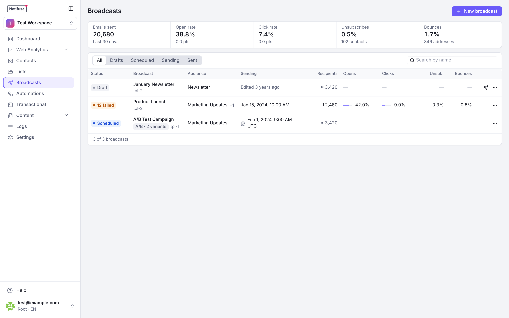
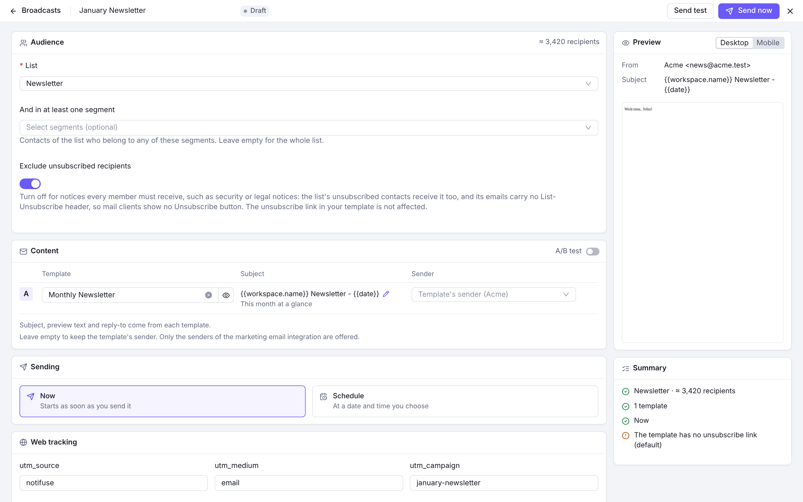
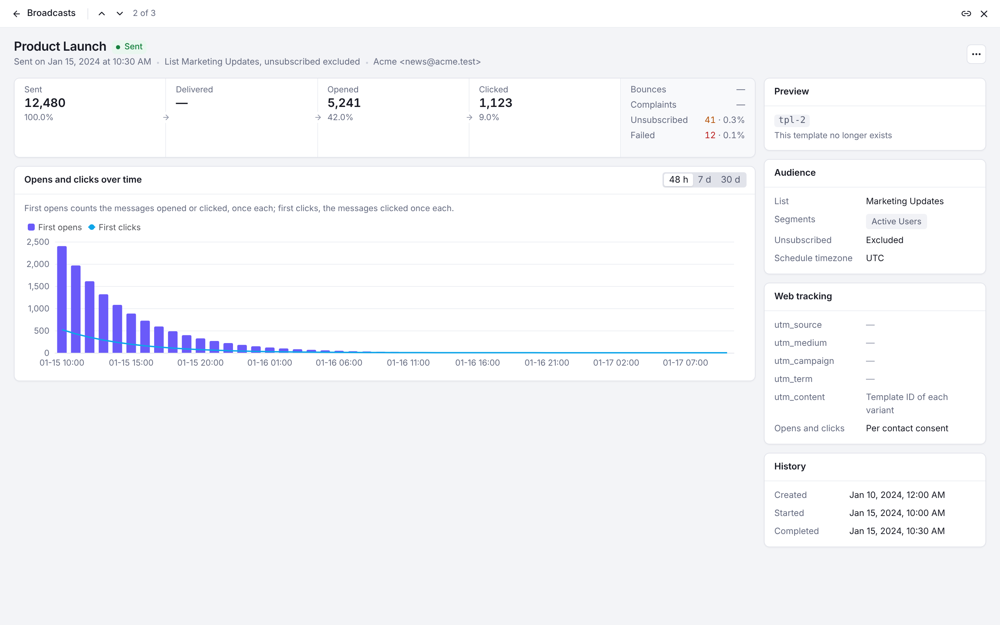

The **Broadcasts** page lists your campaigns with their results over the last 30 days: emails sent, open and click rates, unsubscribes and bounces. Tabs filter by status (Drafts, Scheduled, Sending, Sent, and Failed when a broadcast has failed recipients), with the number of broadcasts in each, and the search finds a broadcast by name. Each row shows the audience, when it was sent or is scheduled, its recipients (an estimate before it is sent), its opens, clicks, unsubscribes and bounces, and the website visits it brought when you have [web analytics](/web-analytics/setup). A draft opens in the editor; any other broadcast opens its results. In an open broadcast, <kbd>J</kbd> and <kbd>K</kbd> move to the next and previous one.

## Audience Targeting

Broadcast campaigns offer flexible audience targeting through a contact list combined with optional dynamic segments, allowing you to reach the right people with precision.

### Select a List

Each broadcast targets exactly one contact list:

- **Single List**: Choose one contact list as your base audience
- **Clear Attribution**: Message history and unsubscribes are tracked per list
- **Simple Model**: No duplicate handling needed since each contact appears once per list

**Example**: Send a product announcement to your "Newsletter Subscribers" list.

### Notices for Every Member

By default a broadcast leaves out the list's unsubscribed contacts. For a notice every member must receive, such as a security, outage or legal notice, switch **Exclude unsubscribed recipients** off: the list's unsubscribed contacts receive it too, and its emails carry no `List-Unsubscribe` header, so mail clients show no Unsubscribe button on them. Bounced and complained contacts are still never emailed, and the unsubscribe link in your template is unchanged. See [Lists](/features/lists) for the subscription statuses.

### Segment Filters

Apply dynamic segment filters to further refine your broadcast audience based on contact properties and behavior:

- **Property-Based Filtering**: Target contacts by `lifetime_value`, `orders_count`, location, or any custom fields
- **Behavioral Filtering**: Reach contacts based on email engagement (opens, clicks, bounces)
- **Combined Filters**: Use multiple segment conditions with AND/OR logic for precise targeting
- **Real-Time Updates**: Segment membership is evaluated at send time, ensuring accuracy
- **List + Segment**: Combine list selection with segment filters for maximum targeting precision

#### Segment Filter Examples

- **High-Value Customers**: Send to "All Customers" list + segment filter for `lifetime_value >= 1000`
- **Re-engagement**: Target "Newsletter" list + segment for contacts who haven't opened emails in 90 days
- **Geographic Campaigns**: Use "All Contacts" + segment filter for `country = "US"` AND `state = "California"`
- **Purchase Behavior**: Target segments with `orders_count >= 3` to reward loyal customers

**Important**: When both a list and segment filters are applied, only contacts that belong to the selected list AND match the segment criteria will receive the broadcast.

## Sender

A broadcast always sends through the workspace's marketing email integration. By default each email leaves from its template's sender, or from the integration's default sender when the template has none.

To send a campaign from another address without editing the template, choose a **Sender** next to the template in the **Content** card of the broadcast editor. Only the senders of the marketing email integration are offered; clearing the field goes back to the template's sender. Over the API, set `sender_id` on the variation in `test_settings.variations`.

The broadcast never falls back to another address:

- A sender that is not one of the integration's is refused when the broadcast is saved.
- If the chosen sender is removed from the integration afterwards, that variation's remaining recipients are not queued until you choose another one. The broadcast cannot be scheduled, and cannot be resumed while that variation still has recipients to queue.
- A broadcast queuing that variation's recipients when the sender is removed pauses the next time its sending task runs. Click **Change sender** next to **Resume** on the paused broadcast, choose another sender, then resume it.
- In an A/B test, once a winner is chosen, a losing variation's removed sender no longer stops the broadcast. It is still checked when the variations are saved, so when the **Change sender** dialog is shown, it asks for that sender too.
- Emails already queued keep the sender they were queued with, including once you resume. A broadcast whose recipients are all queued offers no **Change sender**: a new sender would change nothing.

## A/B Testing

Optimize your campaigns by testing different variations with your audience.

### Test Setup

- **Sample Size**: Test variations on a percentage of your total recipients
- **Multiple Variations**: Create different subject lines, content, or templates
- **Sender per Variation**: Each variation keeps its template's sender or chooses another one, so the sender can be part of what you test
- **Control Groups**: Automatically split your test audience evenly

### Winner Selection

#### Manual Selection

- **Review Results**: Analyze performance metrics for each variation
- **Choose Winner**: Manually select the best-performing variation
- **Send to Remaining**: Deploy the winning variation to the rest of your audience

#### Automatic Selection

Configure automatic winner selection based on performance metrics:

**Open Rate Winner**

- **Metric**: Highest email open rate percentage
- **Time Period**: Set a specific duration (e.g., 2 hours, 24 hours)
- **Auto-Deploy**: Automatically send winning variation after the period

**Click Rate Winner**

- **Metric**: Highest click-through rate percentage
- **Time Period**: Set a specific duration for evaluation
- **Auto-Deploy**: Automatically send winning variation after the period

Rates are counted over the recipients whose opens or clicks were tracked, which depends on their [tracking consent](/features/email-tracking). A broadcast sent without tracking cannot pick its winner automatically.

### A/B Testing Example

1. Create campaign with 2 subject line variations
2. Set test sample to 20% of your audience
3. Configure automatic winner selection based on open rate after 4 hours
4. System automatically sends winning variation to remaining 80%

## UTM Tracking

### Automatic UTM Parameters

All external links in your email templates automatically receive UTM parameters for comprehensive tracking:

- **utm_source**: Identifies the email source
- **utm_medium**: Set to "email" for all broadcast campaigns
- **utm_campaign**: Uses your campaign name for tracking
- **utm_content**: Automatically set to the template ID for content identification

### Example UTM Implementation

**Original Link**: `https://yourwebsite.com/products`

**With UTM Parameters**:

```
https://yourwebsite.com/products?utm_source=notifuse&utm_medium=email&utm_campaign=summer_sale_2024
```

### Sending Without Open and Click Tracking

Check **Don't track opens and clicks for this broadcast** to send it with no tracking pixel and no click redirect, for every recipient. UTM parameters are kept. Otherwise each recipient's [tracking consent](/features/email-tracking) applies.

### Per-Link Statistics

The **Clicked links** panel of a broadcast's results lists each clicked link with its unique clicks, click rate and total clicks, for all variations or for one. **See who clicked**, on each row, opens the [message log](/features/logs#filtering-options) on the emails
where the link was clicked. To act on those clicks, for instance to add the contacts to a list, use the
[Clicked a link](/features/automations#link-click-triggers) automation trigger.

### Analytics Integration

- **Notifuse Web Analytics**: Attribute the visits these links produce, in your own database — the parameters above are what the built-in Email channel rule matches on. See [Web Analytics → Attribution](/web-analytics/attribution).
- **Google Analytics**: Track email performance in your analytics dashboard
- **Campaign Attribution**: Understand which emails drive website traffic and conversions
- **ROI Measurement**: Calculate campaign effectiveness and return on investment

## Data Feeds

Data feeds allow you to fetch external data from your APIs and use it in your email templates. This enables dynamic, personalized content that goes beyond stored contact properties.

### Global Data Feed

The global data feed fetches data once before the broadcast starts and makes it available to all recipients.

#### Configuration

- **Enable Toggle**: Turn on to activate the global data feed
- **Feed URL**: The HTTPS endpoint that returns JSON data
- **Custom Headers**: Add authentication or custom headers (e.g., `Authorization: Bearer token123`)

#### How It Works

1. When the broadcast starts, Notifuse sends a POST request to your configured URL
2. The request body includes broadcast, list, and workspace information:
```json
{
  "broadcast": {
    "id": "abc123",
    "name": "Summer Sale"
  },
  "list": {
    "id": "list456",
    "name": "Newsletter Subscribers"
  },
  "workspace": {
    "id": "ws789",
    "name": "My Company"
  }
}
```
3. Your API should return a JSON object with the data you want to use
4. The data is cached and available in templates as the `global_feed` variable

#### Template Usage

Access global feed data in your templates using the `global_feed` variable:

```liquid

  <h2>{{ global_feed.promotion.title }}</h2>
  <p>{{ global_feed.promotion.description }}</p>
  <a href="{{ global_feed.promotion.url }}">Shop Now</a>

```

#### Use Cases

- **Dynamic Promotions**: Fetch current sale information, discount codes, or featured products
- **Real-time Content**: Display live inventory counts, pricing, or availability
- **Centralized Data**: Pull content from a CMS or marketing platform

### Per-Recipient Data Feed

The per-recipient data feed fetches personalized data for each individual recipient before sending their email.

#### Configuration

- **Enable Toggle**: Turn on to activate the per-recipient data feed
- **Feed URL**: The HTTPS endpoint that returns JSON data (must use HTTPS)
- **Custom Headers**: Add authentication or custom headers

#### How It Works

1. Before sending each email, Notifuse sends a POST request to your configured URL
2. The request body includes contact, broadcast, list, and workspace information:
```json
{
  "contact": {
    "email": "john@example.com",
    "external_id": "user_789",
    "timezone": "America/New_York",
    "language": "en",
    "first_name": "John",
    "last_name": "Doe",
    "full_name": "John Doe",
    "phone": "+1234567890",
    "address_line_1": "123 Main St",
    "address_line_2": "Apt 4B",
    "country": "US",
    "postcode": "10001",
    "state": "NY",
    "job_title": "Engineer",
    "custom_string_1": "value",
    "custom_number_1": 42,
    "custom_datetime_1": "2024-06-15T00:00:00Z",
    "custom_json_1": {"key": "value"},
    "created_at": "2024-01-15T10:30:00Z",
    "updated_at": "2024-06-01T14:00:00Z"
  },
  "broadcast": {
    "id": "abc123",
    "name": "Summer Sale"
  },
  "list": {
    "id": "list456",
    "name": "Newsletter Subscribers"
  },
  "workspace": {
    "id": "ws789",
    "name": "My Company"
  }
}
```

All contact fields are included when populated. Empty fields are omitted. Custom fields (`custom_string_1` through `custom_string_5`, `custom_number_1` through `custom_number_5`, `custom_datetime_1` through `custom_datetime_5`, `custom_json_1` through `custom_json_5`) are included when set on the contact.

3. Your API should return a JSON object with personalized data for that contact
4. The data is available in templates as the `recipient_feed` variable

#### Template Usage

Access per-recipient feed data using the `recipient_feed` variable:

```liquid

  <h3>Recommended for You</h3>
  
    <div>
      
      <p>{{ product.name }} - ${{ product.price }}</p>
    </div>
  

```

#### Use Cases

- **Product Recommendations**: Fetch personalized product suggestions based on purchase history
- **Account Information**: Display current subscription status, points balance, or loyalty tier
- **Dynamic Content**: Show content based on user preferences stored in your system

### Error Handling

#### Automatic Retry

If a per-recipient feed request fails, Notifuse automatically retries:

- **Retry Attempts**: 2 retries before marking as failed
- **Retry Delay**: 5 seconds between attempts
- **Graceful Degradation**: If all retries fail, the broadcast pauses automatically

#### Circuit Breaker

To protect your broadcast from cascading failures:

- **Failure Detection**: If feed requests consistently fail, the broadcast pauses
- **Manual Resume**: After fixing the issue, manually resume the broadcast from the UI
- **Skipped Recipients**: Failed recipients are marked in Message History Logs

### Performance Considerations

#### Global Feed

- **Single Request**: Only one API call per broadcast, regardless of audience size
- **Cached Data**: Data is fetched once and reused for all recipients
- **Recommended**: Use for data that's the same for all recipients

#### Per-Recipient Feed

- **Request Per Recipient**: One API call for each recipient in your audience
- **Processing Impact**: Can significantly slow down broadcast processing for large audiences
- **API Rate Limits**: Ensure your API can handle the request volume
- **Recommended**: Use only when truly personalized data is required

#### Best Practices

- **Fast API Responses**: Keep your feed endpoints fast (under 2 seconds)
- **Reliable Infrastructure**: Ensure high availability for your feed endpoints
- **Fallback Content**: Design templates to gracefully handle missing feed data
- **Test Before Sending**: Use the "Test" button to verify feed responses before launching

### Security

Data feed URLs are fetched by the Notifuse server, so they are protected against [server-side request forgery (SSRF)](https://owasp.org/www-community/attacks/Server_Side_Request_Forgery):

- **Private addresses are blocked**: By default, the server refuses to connect to private, loopback, link-local, and other reserved IP ranges — including the cloud instance metadata endpoint. This applies whether a feed points at such an address directly or via a hostname that resolves to one, and redirects are re-validated to prevent DNS rebinding.
- **Write access required**: Adding, testing, or refreshing a data feed requires the `broadcasts` **write** permission — the same access needed to create a broadcast. Members with read-only access cannot trigger feed requests.

<Note>
  **Self-hosting:** if you intentionally serve data feeds from services on your own internal network, you can allow private addresses by setting `BROADCAST_DATA_FEED_ALLOW_PRIVATE_HOSTS=true`. This disables SSRF protection for data-feed requests, so only enable it in trusted environments. See [Environment Variables](/self-hosting/installation#optional-variables).
</Note>

## Permissions

Broadcasts answer to the **Broadcasts** permission: **read** opens broadcasts, their configuration and their A/B test results; **write** creates and edits them, manages data feeds, and schedules, sends, pauses, resumes, cancels and deletes them.

Two things about that are easy to get wrong:

- **Broadcasts write sends to your entire audience.** The switch that lets someone draft a campaign is the switch that lets them push it out. There is no separate "may send" grant.
- **Broadcasts read does not include delivery statistics.** Delivered, open, click, bounce and per-link counts come from the message log, so they need **Message History** read. The recipient list needs **Contacts** read. A member holding Broadcasts read alone sees the campaign, not its results.

See [Admins & API Keys](/features/admins-api-keys).

## Writing a Broadcast

**New broadcast** opens the editor: one screen with the audience, the content, when to send, web tracking and the advanced settings, beside a live preview and a summary.



- **Saved as you type**: the broadcast is created as a draft once it has a name and a list, then every change is saved a second after you stop typing. The bar at the top says when it was last saved, or what is missing. Closing with changes not yet saved asks first.
- **Audience**: choose a list and, optionally, segments. The number of recipients is estimated as you go, from the list's active contacts and the segments you add.
- **Content**: choose a template for each variant. The subject, preview text and reply-to come from the template; the pencil opens it to edit them. Turn **A/B test** on to add variants and set the test sample, the winner metric and the test duration.
- **Preview**: the email as it will look on desktop or on a phone, for each variant.
- **Summary**: every check before sending, such as a missing list or template, a sender that no longer exists, a template without an unsubscribe link, or no marketing email provider. **Send now** stays disabled until the errors are fixed.
- **Send test** sends the chosen template to the addresses you give.

### Sending Now or Later

- **Now**: **Send now** asks you to confirm with the number of recipients, then the broadcast starts sending and its results open.
- **Schedule**: choose a date, a time and a timezone (the workspace's by default), then **Schedule**. A scheduled broadcast can still be edited until it starts: change it, then **Save changes**. Cancel it from its results.

### Scheduling Best Practices

- **Optimal Timing**: Schedule for when your audience is most active
- **Time Zone Considerations**: Consider your audience's geographic distribution
- **Avoid Peak Times**: Prevent delivery during holidays or industry-specific busy periods

## Results



A sent broadcast opens on its results:

- **Funnel**: sent, delivered, opened and clicked, with bounces, complaints, unsubscribes and failures beside them.
- **Opens and clicks over time**: first opens and first clicks over 48 hours, 7 days or 30 days from the start of sending, with the moments the A/B test and the winner were sent.
- **A/B test**: each variant with its template, subject, sender and results, the winner once chosen, and **Pick as winner** while the test waits for you.
- **Clicked links**: see [Per-Link Statistics](#per-link-statistics).
- **Beside them**: the preview, the audience, the UTM parameters, the sending task and the broadcast's history (created, started, test and winner sent, completed, paused).

The header gives the status and the actions it allows: edit a draft or scheduled broadcast, send a test, pause, resume, change sender, retry failed recipients or cancel, and, with web analytics, open the broadcast's website traffic. The "…" menu refreshes the statistics, opens the sending logs and the website conversions, and deletes the broadcast.

## Sending Speed

Broadcasts and automation emails go out through the email queue, at the **Rate Limit for Marketing** set on each email integration, in emails per minute.

- **Set the limit to what your provider accepts, minus your other traffic on the same account.** Transactional emails are sent as soon as the API is called and don't count against this limit, but when they go through the same provider account they use the same quota. So do other integrations on that account, in this workspace or another: their limits add up. Amazon SES states its quota per second: 100 emails per second is 6,000 per minute.
- **The limit is a maximum, and it applies per Notifuse instance.** Several instances sharing one database each apply it on their own, and each slows down on its own when the provider asks it to (see below). While the limit is what holds them back, they compete for the same emails and together send at about the limit; when it is set above what one instance can reach (see below), their rates add up and can exceed it. Below the limit, an instance's pace is set by the points that follow.
- **Emails sent at once.** Each email integration sends up to 10 emails at once, and SMTP integrations one at a time: each SMTP email opens its own connection, and many SMTP servers refuse several at once. An integration can't go faster than that number divided by the time one email takes, which is the provider's answer plus about three queries on the workspace's database: 10 at once at 100 ms each is 6,000 per minute, and one at a time at 300 ms each is 200 per minute. A self-hosted instance can raise `EMAIL_QUEUE_CONCURRENCY`, or `EMAIL_QUEUE_SMTP_CONCURRENCY` if its SMTP server accepts several connections (see [Installation](/self-hosting/installation#optional-variables)). That helps when the provider's answer is what takes time. When the database's queries are, with a distant database for instance, the workspace's few connections, shared with the API (`DB_MAX_CONNECTIONS_PER_DB`, 3 by default), are what hold sending back.
- **Rounds.** An integration sends at most 200 emails per round, and a round starts at most once a second, so it never goes above about 12,000 per minute per instance. A round ends when every integration on the instance has sent its emails for it. While another integration is sending as fast as its own limit allows, a round takes about two seconds, or less when that limit is above 6,000 per minute. This brings the ceiling down to 6,000 per minute, or to that integration's limit when it is between 6,000 and 12,000. Rounds take longer when an integration's emails are slow to send.
- **Workspaces.** An instance sends for five workspaces at a time. With more than five sending at once, they take turns, and each stays below its limit.

### When the Provider Asks to Slow Down

A limit above what the provider accepts makes it answer that emails arrive too fast. The integration then slows down by a quarter each time, down to a tenth of its limit (at least one email per minute), and once emails go through again it climbs back by 5% of its limit every 10 seconds, up to the limit. The refused email is sent again at the slower pace, keeps its delivery attempts, and its broadcast keeps sending. Until it is sent, the email shows nothing in Message History, except Mailgun automation emails, which show the refusal until then. Keep the limit at or below what the provider accepts anyway: each climb past it costs a few refused emails.

- **What counts as "too fast"**: an HTTP 429 from SendGrid, Mailgun, Mailjet, SparkPost or Postmark, a throttling error from Amazon SES, and an SMTP refusal with a 4xx code that says so (rate limit, too many messages, sending rate…), unless it blames the recipient's mailbox.
- **Quotas are not "too fast"**: a refusal that names a daily, hourly or monthly quota, or credits, is a provider failure. SendGrid, Mailgun, Mailjet and SparkPost refusals carry only their status code, so a quota they answer with a 429 looks like "too fast": the integration first slows down to a tenth of its limit.
- **When slowing down is not enough**: refusals that continue for 30 seconds at a tenth of the limit are provider failures too.

Other refusals from the provider are failures. A failed email is retried one minute later, then two minutes after that, and given up at its third refusal; retrying the broadcast sends it again. Several failures in a row pause the integration's broadcasts (see below), and its other queued emails, such as automation emails, wait for the cooldown. The integration then sends one of them as a test and, if it goes through, sends again, climbing back to its limit if it had slowed down. A broadcast running an A/B test is paused only once all its emails are queued; until then, its emails wait like the others. With Amazon SES, the client first retries a refused email for several seconds, which holds up the round for the other integrations on the instance.

## Transmission Failure Handling

### Circuit Breaker Protection

Notifuse includes built-in protection against email delivery issues through a circuit breaker mechanism:

- **Failure Threshold**: After 5 consecutive transmission failures, the circuit breaker automatically pauses the broadcast. A provider asking to slow down is not a failure (see [When the Provider Asks to Slow Down](#when-the-provider-asks-to-slow-down))
- **Automatic Pause**: The broadcast status changes to "Paused" with a clear reason indicating the circuit breaker was triggered
- **Immediate Protection**: This prevents further failed attempts and protects your sender reputation

### Failed Message Behavior

When the circuit breaker triggers:

- **Recipients Are Kept**: Everything still queued is paused, not discarded, and keeps its remaining delivery attempts. Only the handful of messages that were actually refused have spent one; those the provider refused for good, or on their last attempt, are given up instead. On a single Notifuse instance, an email still being sent when it triggers is paused with the rest if the provider fails it, unless it was on its last attempt; one refused for its recipient is given up as usual.
- **Failed Messages**: Those recipients are marked as "failed" in the Message History Logs, with the provider's own explanation in the Error column.
- **Recoverable**: Nothing is lost by the pause itself. Resume sends the paused recipients, and any that were given up on can be retried separately.

### Manual Resume Required

- **Manual Intervention**: Broadcasts paused by the circuit breaker must be manually resumed from the UI
- **Root Cause Analysis**: Before resuming, investigate and resolve the underlying delivery issues
- **Fresh Start**: When resumed, the broadcast continues from where it left off. Recipients whose attempts were all used up are not resumed automatically — use Retry for those.

### Retrying Failed Recipients

A recipient whose delivery attempts were all refused is held for **7 days**, so you can send to them again once the cause is fixed.

- **Where**: A broadcast that finished with failures shows "N failed" instead of "Sent". **Retry failed** is in its header, and in the "…" menu of its row in the list.
- **When**: Only once the broadcast has finished sending. A broadcast still working through its queue, or one that is paused, has to finish or be resumed first.
- **What happens**: The same email is sent again to those recipients. Fix whatever the provider objected to before retrying, or it will fail a second time.
- **Over the API**: `POST /api/broadcasts.retryFailed` with `workspace_id` and `id`, which answers with how many recipients were requeued.

<Warning>
  After 7 days the failed recipients are cleared and can no longer be retried from the broadcast.
</Warning>

### What "Complete" Means

A broadcast reads as complete only when its queue is empty and nobody was given up on. The **Sent** figure counts the messages the email provider accepted — a message it refused is counted under **Failed**, never under Sent.

### Common Failure Scenarios

Circuit breaker activation typically occurs due to:

- **Email Provider Issues**: Temporary outages, a sending quota reached, or a provider still refusing at a tenth of the limit
- **Authentication Problems**: Invalid API keys or credentials
- **Configuration Errors**: Incorrect SMTP settings or provider configuration
- **Reputation Issues**: High bounce rates or spam complaints

### Recovery Steps

1. **Check Message History Logs** to identify the specific failure reasons
2. **Resolve the underlying issue** (fix credentials, contact provider, etc.)
3. **Resume the broadcast** manually from the campaign interface
4. **Monitor closely** to ensure successful delivery continues

## Best Practices

- **List Segmentation**: Use segment filters to target specific subsets of your list
- **A/B Testing**: Always test subject lines and content for better engagement
- **UTM Consistency**: Use consistent campaign naming for better analytics tracking
- **Data Feeds**: Use global feeds for shared data; reserve per-recipient feeds for truly personalized content
- **Schedule Strategically**: Time your sends for maximum audience engagement
- **Monitor Performance**: Review metrics to improve future campaigns
- **Provider Monitoring**: Keep an eye on your email provider status and limits
- **Test Campaigns**: Send test campaigns to verify configuration before large broadcasts
