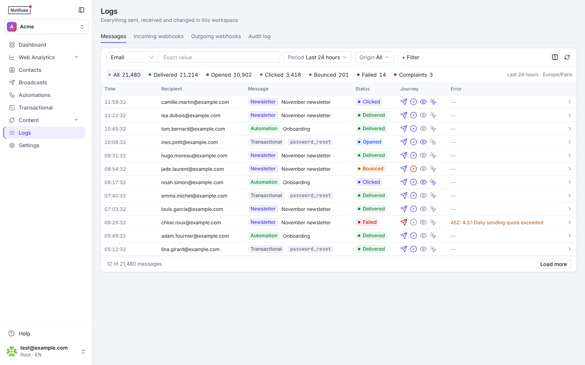
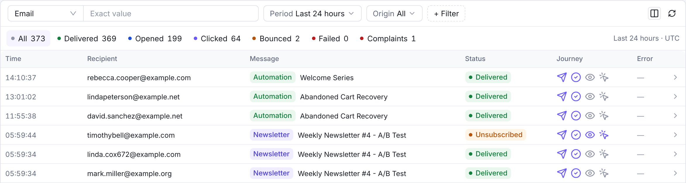
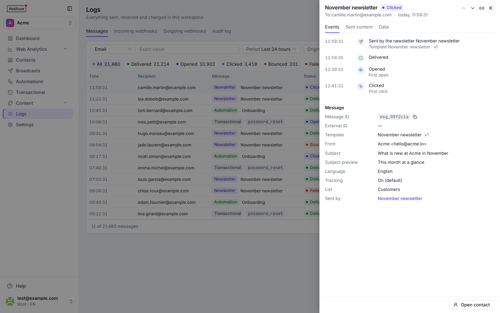
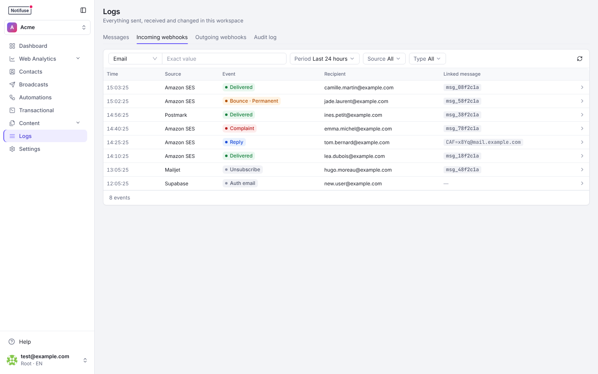

## Overview

Logs provide real-time monitoring of email activity and webhook events to help debug email delivery issues and track campaign performance. The same section also holds the deliveries of your own webhooks and the workspace's **audit trail** — who did what, from where — each on its own tab: **Messages**, **Incoming webhooks**, **Outgoing webhooks** and **Audit log**.

## Log Types

### Messages Tab

Every email the workspace sent, newest first, over the **last 24 hours** by default. Pick another period (last hour, 7 days, 30 days or all time) from the **Period** filter.

- **Counts by status**: All, Delivered, Opened, Clicked, Bounced, Failed and Complaints. Click one to list only those messages. Counts are shown up to 7 days. For 30 days or all time, add a filter on an email address, a message ID, a newsletter, an automation, a transactional notification or a template. A workspace that sends only through SMTP shows no Delivered count, since SMTP reports no delivery.
- **Search**: by email address, message ID or external ID, with exact matching. Typing an "@" switches the search to the email address, unless you picked the field yourself. An email address is searched once it is complete.
- **Origin**: newsletters, automations, transactional notifications, or other messages.
- **Journey**: each row shows how far the message went: sent, delivered, opened, clicked.
- **Error**: when a send was refused, the provider's own reply — the SMTP code and the text that came with it, such as `452: 4.3.1 Daily sending quota exceeded`. Hover to read the whole of it.
- **Columns**: show or hide the message ID, external ID, metadata, template, list and creation date from the column picker.

Click a message to open it in a side panel. Move to the previous or next message with **K** and **J**.

- **Events**: when it was sent, delivered, opened, clicked, bounced or marked as spam.
- **Message**: its IDs, template and version, sender, subject, language, tracking, list, attachments, and the newsletter, automation or transactional notification that sent it.
- **Sent content**: the email rendered again from its template and the message's data, in the contact's language, as HTML, text or MJML. Notifuse doesn't store the sent HTML. It renders the template again, at the version the message used, so later edits to the template don't show.
- **Data**: the template data and the metadata the message was sent with.
- **Open contact** opens the contact's profile.

When a contact is erased, their messages stay in the log as **Contact erased**, without their data.

### Incoming Webhooks Tab

The events Notifuse kept from your email providers and Supabase, newest first, over the last 24 hours by default.

- **Filters**: search by recipient email or message ID; filter by period, by **Source** (Amazon SES, Postmark, Mailgun, SparkPost, Mailjet, SendGrid, SMTP, Supabase) and by **Type** (delivered, bounce, complaint, unsubscribe, reply, auto-reply, auth email, user created). The filters are kept in the page's link.
- **Linked message**: a delivery, bounce, complaint or unsubscribe event links to the message it is about. A reply carries the reply's own message ID, so it links nowhere.
- **Raw payloads**: click an event to see its bounce or complaint details and its data exactly as the provider sent it. When a provider sends its events in batches (SendGrid, SparkPost, Mailjet), each event keeps its own entry of the batch.
- **Emails Notifuse sent**: a delivery, bounce, complaint or unsubscribe event is listed and acted on only when it is about an email Notifuse sent, for the address it went to; a reply, when it answers an email Notifuse sent. Events about other mail, such as another application's on the same provider account or an integration's test email, are ignored.

### Outgoing Webhooks Tab

Every delivery of your [webhook subscriptions](/features/webhooks), newest first:

- **Filters**: by subscription and by status (Pending, Delivering, Delivered, Failed), kept in the page's link
- **Retrying**: a failed delivery that still has attempts left reads **Retrying**, and its side panel gives the time of the next attempt. The **Failed** filter lists these deliveries too
- **Delivery Detail**: click a delivery to see the response code and body your endpoint answered with, and the payload Notifuse sent. **Open subscription** goes to that subscription in Settings → Webhooks

### Audit Log Tab

Each entry reads as a sentence, such as "Invited **ann@example.com**", filtered by period, actor, resource, action or outcome, with its filters kept in the page's link.

- **Who Did What**: Every control-plane action — a member invited, a permission changed, an API key created, an integration edited, a template saved, a broadcast scheduled — with the actor, the IP address, the outcome and a before/after of what changed
- **Append-Only**: A database trigger refuses every rewrite; the retention purge is the only deletion
- **Exportable**: Download the current filter as CSV or NDJSON, or pull it over the API into a SIEM

Recording is an Enterprise [licence key](/self-hosting/licence) capability; the tab, its export and its retention setting work in every licence state. See [Audit logs](/features/audit-logs) for the full reference.

## Event Updates

Email events are updated in real-time as email provider webhooks are received:

- **Delivered**: Email successfully delivered to recipient
- **Opened**: Recipient opened the email
- **Clicked**: Recipient clicked a link in the email
- **Bounced**: Email delivery failed
- **Complained**: Recipient marked email as spam

## Filtering Options

Besides the search, the period, the origin and the counts, **+ Filter** on the Messages tab adds:

- **Status**: delivered, opened, clicked, bounced, failed, complained or unsubscribed, or their opposite (not delivered, not opened…)
- **Channel**: the channel the message went through
- **List**, **Newsletter** and **Automation**: chosen by name
- **Template** and **Transactional notification**: by ID. The detail view of a notification opens the log with this filter (`transactional_notification_id` in `messages.list`)
- **Clicked link**: within a newsletter, show only the messages on which this exact link was clicked. The per-link statistics of a broadcast open the log with this filter (**See who clicked**). Through the API, pass `clicked_url` with `broadcast_id` to `messages.list`

Every filter is kept in the page's link, so a filtered view can be shared or bookmarked. Through the API, `messages.count` returns the same counts for the filters of `messages.list`. It needs `created_after`, or a filter on a message ID, an email address, a newsletter, an automation, a transactional notification or a template.

## Permissions

The page shows only the tabs you may read, and the Logs menu entry appears as soon as you may read one of them. The tabs answer to different permissions, all read rights:

- **Messages** needs **Message History** read. This is also where broadcast delivery statistics live — delivered, open, click, bounce and per-link counts — so a member who may create and send a broadcast still cannot see how it performed without it. The log carries recipient addresses and the data each message was rendered with, so treat it as contact data.
- **Incoming webhooks** needs **Webhook Events** read. These are the providers' own payloads, including recipient addresses and provider diagnostics.
- **Outgoing webhooks** needs **Webhook Subscriptions** read.
- **Audit log** needs **Audit logs** read, which an owner grants deliberately — it is never part of full access, because full access should not imply reading every colleague's email address, IP address and refused actions. Owners always see the tab, and a root user can switch it to the whole deployment.

The write verb of Message History, Webhook Events and Audit logs gates nothing today: these rows are written by the sending pipeline, by the provider callback routes and by the platform's own audit recorder, never by anything you can call. Webhook Subscriptions write is different: it lets a member or an API key create, edit, switch on or off, delete and test the subscriptions themselves (Settings → Webhooks in the console). See [Admins & API Keys](/features/admins-api-keys).

## Debugging Email Issues

Logs are essential for troubleshooting email provider problems:

- **Delivery Failures**: Identify bounced emails and reasons, and read why a send was refused in the Error column
- **Provider Issues**: Spot patterns in webhook failures
- **Performance Monitoring**: Track open and click rates
- **Real-Time Debugging**: Immediate feedback on email sending issues
