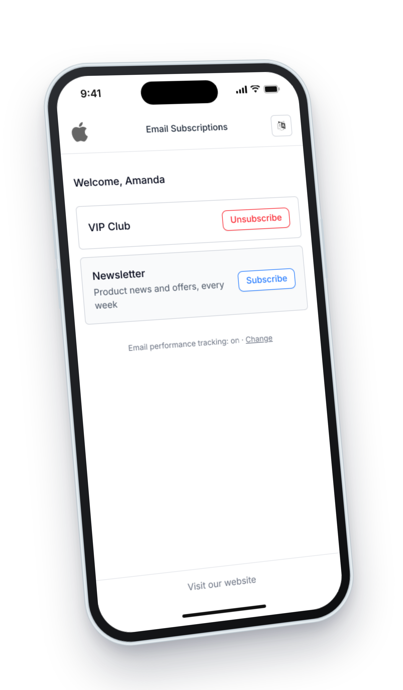

Example:

<Frame>
  

</Frame>

## Features

### Automatic Rendering

- Displays automatically when users click unsubscribe links
- Mobile-responsive design
- No configuration required

### Multi-Language Support

Automatically detects browser language and displays content accordingly. Supported languages:

- English (en)
- French (fr)
- Spanish (es)
- German (de)
- Chinese (zh)
- Hindi (hi)
- Arabic (ar)
- Portuguese (pt)
- Russian (ru)
- Japanese (ja)
- Polish (pl)

Defaults to English if browser language is not supported.

When the contact clicks, taps or presses a key on the page, their browser's timezone is saved to their profile, and so is their browser's language if their profile has none. Opening the page alone saves nothing, so email security scanners that open links in a browser don't change contact data.

### Subscription Management

Users can:

- View all public lists, and the private lists they are active or pending on
- Subscribe/unsubscribe with one click
- Leave a private list, which then disappears from their preferences. Only the workspace can add them back (see [Private Lists](/features/lists#private-lists)).
- See real-time feedback messages

### Email Tracking

When the workspace tracks opens or clicks, a line at the bottom of the page says whether email performance tracking is on, off or partly on for the contact. Its **Change** link opens a dialog where the contact allows or stops open tracking and click tracking. Their choice is recorded with source `notification_center` and applies to the next emails and to opens and clicks of emails already sent. See [Email Tracking](/features/email-tracking).

### Unsubscribe from the Mail Client

Broadcasts, and emails sent by automations attached to a list, carry the `List-Unsubscribe` and `List-Unsubscribe-Post` headers ([RFC 8058](https://www.rfc-editor.org/rfc/rfc8058)), so Gmail, Yahoo, Outlook and other mail clients can show their own **Unsubscribe** button next to the sender:

- **One-click**: when the mail client offers one-click unsubscribe, the contact is unsubscribed from the list right away. The contact's click on the mail client's button is the confirmation.
- **Opened in a browser**: mail clients that don't offer one-click open the link instead. The notification center then shows the list and asks the contact to confirm, because anti-spam filters also open these links on their own.

Mail clients only offer one-click when the email's DKIM signature covers both headers, and that signature is applied by your email provider.

A broadcast with **Exclude unsubscribed recipients** switched off, used for notices every member must receive such as security, outage or legal notices, carries neither header, so mail clients show no Unsubscribe button on it.

## Configuration

### Branding

The notification center uses:

- Logo from workspace settings
- Website URL from workspace settings

## Technical Details

### User Flow

What happens depends on the link the contact followed:

- **Unsubscribe link in the email** (`{{ unsubscribe_url }}`): the contact is unsubscribed from that list as soon as the page opens, and the page confirms it. They can then manage their other lists.
- **The mail client's Unsubscribe button**: unsubscribes in one click, or opens a page that asks the contact to confirm, as described in [Unsubscribe from the Mail Client](#unsubscribe-from-the-mail-client).
- **Preferences link** (`{{ notification_center_url }}`): shows the contact's lists, and each subscribe or unsubscribe applies immediately.
- **Tracking preferences link** (`{{ tracking_preferences_url }}`): opens the page with the email tracking dialog open. Nothing changes until the contact chooses.
- **Tracking opt-out link** (`{{ tracking_optout_url }}`): opens the page with a dialog asking the contact to confirm, then stops both open and click tracking (source `email_link`).

### Implementation

- Cross-browser compatible
- Responsive design
- Secure subscription handling
- Error handling with localized messages
