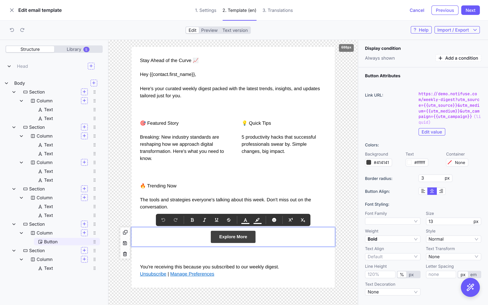
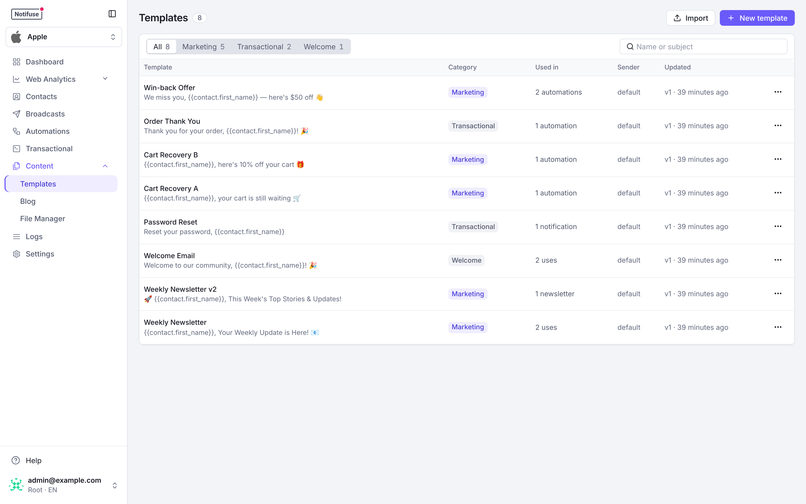

## Overview

Email templates in Notifuse are built using a **visual drag-and-drop editor** that combines:

- **MJML Framework**: Guarantees full email client compatibility across all devices and email providers
- **Liquid Templating**: Dynamic content personalization using variables like `{{ contact.first_name }}`
- **Version Control**: Every template update creates a new version to track previously sent contents
- **Multi-Purpose**: Used by both broadcast campaigns and transactional notifications

## Template Builder Features

- **Drag-and-Drop Interface**: Visual editor for easy template creation
- **Responsive Design**: Mobile-optimized layouts that work across all devices
- **Pre-built Blocks**: Headers, footers, buttons, images, and content sections
- **Brand Consistency**: Colors, fonts, logos, and styling options
- **Real-time Preview**: See exactly how your email will look before sending

## Editor modes

When you create a template, you choose how its email is written:

- **Visual**: the drag-and-drop editor, where blocks, styles and Liquid variables are edited in place.
- **Code (MJML)**: you write the MJML yourself, with Liquid, in a code editor with a live preview.

The editor mode is set when the template is created and can't be changed afterwards. To move a design to the other editor, create a new template in that mode and copy the content across with the **Import / Export** menu of each editor:

- **Code to visual**: in the code template, use **Export MJML**; in the new visual template, use **Import → MJML** with that file.
- **Visual to code**: in the visual template, use **Export → MJML**; in the new code template, use **Import MJML** with that file.

Check the preview after copying. The visual editor refuses MJML components it doesn't support, and Liquid placed between blocks (for example a `` loop around sections) is not kept when importing into it. In the other direction, write Liquid inside links with single quotes (`{{ link | append: '?ref=mail' }}`): double-quoted text there doesn't survive the export.

The new template has its own ID. Point your broadcasts, transactional notifications and automations at it, then delete the old one.

## Usage

Templates are used across Notifuse for:

- **Broadcast Campaigns**: Mass email campaigns sent to your contact lists
- **Transactional Notifications**: Automated emails triggered by user actions
- **Double Opt-In Emails**: Sent when anonymous contacts subscribe to lists
- **Welcome Emails**: Sent when contacts confirm their subsription to lists
- **Unsubscribe Confirmations**: Sent when contacts opt out



## Deleting a template

Deleting a template removes it from the template list and from every template picker, but Notifuse keeps it, with all its versions: messages already sent were rendered from them, and the message history and broadcast reports still display them.

Because of this, a deleted template keeps its ID. Creating a new template with the same ID is refused, and the API's `templates.update` answers `404` for it. Give the new template another ID.

Deleting a template does take down the [web versions](#view-in-browser) of the emails sent with it.

Templates managed by an integration, such as the [Supabase](/integrations/supabase) auth emails, can't be deleted.

## Translations

A template can carry one version of its content per language. Which version a contact receives is decided at send time from the contact's `language` field, so one broadcast or one transactional notification serves every language you have written — nothing to branch on in your automations or your API calls.

### Enabling languages in the workspace

Translations are only offered for languages the workspace has switched on. Open **Settings → General**:

- **Supported Languages** — the languages this workspace works in. Add every language you intend to write templates for; a language that is not listed here cannot be given a translation.
- **Default Language** — the language a template's main content is written in, and the version a contact receives when nothing better matches. Every workspace has exactly one.

Language codes are two-letter ISO codes such as `en`, `fr`, `de`, `es`. The default language must be one of the supported languages, and the list must contain at least one.

<Note>
  With a single supported language the template editor shows no translation controls at all. The **Translations** tab appears as soon as the workspace supports more than one language.
</Note>

### Writing a translation

When creating or editing a template, the editor has a tab per stage: **Template**, in the workspace's default language, and **Translations**, listing each other supported language. Open a language to write its version: its own subject, preview text and body, with the same visual editor, MJML code mode and Liquid variables as the default. **Reset translation** copies the default-language content into the translation as a starting point, replacing whatever was there.

A language that has no translation is simply skipped at send time — you do not have to translate a template into every supported language at once.

### Which version a contact receives

At send time Notifuse reads the contact's `language`:

1. If it is empty, or equals the workspace's default language, the contact receives the **default content**.
2. If the template has a translation for that language, the contact receives **that translation**.
3. Otherwise the contact receives the **default content**.

So the default content is always the fallback, and a translation is only ever an improvement over it, never a gap. Set a contact's language on import, through the API (`language` on `contacts.upsert`), or from a subscription form; see [Contacts](/features/contacts).

To check a specific language before sending, the template preview and the test-send dialog both have a **Language** selector.

<Note>
  **Self-hosted: adding a language to a template, or editing the content of an existing translation, needs a [licence key](/self-hosting/licence).** Translations already saved keep being sent in every licence state, editing the rest of a template that carries them is never refused, and removing a translation is always allowed. Notifuse Cloud includes template translations from the Starter plan up ([details, including instances still on their earlier terms](/self-hosting/licence#on-notifuse-cloud)).
</Note>

## Liquid Syntax

Notifuse uses Liquid templating to insert dynamic content into your emails. Variables are enclosed in double curly braces and automatically replaced with actual data when emails are sent.

<Note>
  Liquid is evaluated in the template you write, not in your data. A value coming from a contact field, a data feed or an API call is inserted as text: if it happens to contain `{{ ... }}` or ``, that text is shown as-is, not run as Liquid. Put merge tags in the template; feed the data plain values.
</Note>

### Contact Variables

The `contact` object contains the **full contact profile** with all stored information. Access any contact field for personalization:

```liquid
Hello {{ contact.first_name }}!

Your account email: {{ contact.email }}
Full name: {{ contact.first_name }} {{ contact.last_name }}
```

**Output Example:**

```
Hello John!

Your account email: john.doe@example.com
Full name: John Doe
```

### List Variables

Reference the mailing list information:

```liquid
You're subscribed to: {{ list.name }}
List ID: {{ list.id }}
```

**Output Example:**

```
You're subscribed to: Newsletter
List ID: newsletter
```

### System URLs

Use pre-generated URLs for common actions:

#### Unsubscribe Link

```liquid
<a href="{{ unsubscribe_url }}">Unsubscribe from this list</a>
```

Opening this link unsubscribes the contact from the list right away and shows the [notification center](/features/notification-center). Mail clients can also show their own Unsubscribe button, from the `List-Unsubscribe` header that Notifuse adds to every email sent to a list, except broadcasts that also go to the list's unsubscribed contacts.

#### Subscription Confirmation

```liquid
<a href="{{ confirm_subscription_url }}">Confirm your subscription</a>
```

#### Notification Center

```liquid
<a href="{{ notification_center_url }}">Manage your preferences</a>
```

#### Email Tracking Preferences

```liquid
<a href="{{ tracking_preferences_url }}">Choose what we track</a>
<a href="{{ tracking_optout_url }}">Stop tracking my opens and clicks</a>
```

The first opens the email tracking dialog of the notification center; the second asks the contact to confirm in that dialog, then refuses open and click tracking. See [Email Tracking](/features/email-tracking#template-links).

#### View in Browser

```liquid

  <a href="{{ view_in_browser_url }}">View this email in your browser</a>

```

The link opens the web version of the email, for recipients whose mail client renders it badly. In the visual builder, select some text, open the link editor and choose the **Web version of the email** link type.

- **Available in broadcasts and automations.** Transactional and double opt-in emails leave the variable empty, unless a transactional API call sets `view_in_browser_url` in its own data. Guard the link as above in a template shared with them.
- **Only where it is used.** Only emails whose template uses the variable have a web version. There is no workspace setting.
- **The email as it was sent.** The page is rendered from the template version and the data of that send, in the contact's language. Editing the template later does not change it.
- **Nothing is tracked on the page.** Viewing it records no open, and its links record no click; they keep the UTM parameters of the send. With click tracking on, the click on the link in the email itself counts as a click, like any other link.
- **Taken down with the template or the contact.** [Deleting the template](#deleting-a-template) or [deleting the contact](/features/contacts#deleting-a-contact) makes the page answer "This email is no longer available".

Anyone who has the link can open the page, as with a forwarded email. It shows what the email shows, including the contact's unsubscribe and notification center links, so whoever holds it can unsubscribe that contact. Each email's web version opens at most 30 times a minute: it is not meant as a public archive link. The page opens only on your workspace's custom domain, or on the Notifuse endpoint, never on another workspace's domain. It runs no script and is kept apart from the console, although both are served from the same domain.

In a template preview and in a test email, the link opens a page saying that the web version exists once the email is sent to a contact.

<Note>
  Web versions are served under `/v/`. On a [blog](/blog/setup) served from a custom domain, a category whose slug is `v` cannot be reached: give it another slug.
</Note>

### Complete Example

```liquid
Welcome {{ contact.first_name }}!

Thank you for subscribing to {{ list.name }}. We're excited to have you on board!

Your registered email: {{ contact.email }}

Manage Preferences: {{ notification_center_url }}

Don't want to receive these emails?
Unsubscribe here: {{ unsubscribe_url }}
```

### Available Data Structure

When designing templates, you have access to this data structure:

```json
{
  "contact": {
    "first_name": "John",
    "last_name": "Doe",
    "email": "john.doe@example.com"
  },
  "list": {
    "id": "newsletter",
    "name": "Newsletter"
  },
  "unsubscribe_url": "https://your_notifuse_endpoint.your_website.com/notification-center?action=unsubscribe&email=john.doe@example.com&lid=newsletter&lname=Newsletter&wid=workspace123&mid=msg_123&email_hmac=abc123",
  "confirm_subscription_url": "https://your_notifuse_endpoint.your_website.com/notification-center?action=confirm&email=john.doe@example.com&lid=newsletter&lname=Newsletter&wid=workspace123&mid=msg_123&email_hmac=abc123",
  "notification_center_url": "https://your_notifuse_endpoint.your_website.com/notification-center?email=john.doe@example.com&email_hmac=abc123&wid=workspace123",
  "tracking_preferences_url": "https://your_notifuse_endpoint.your_website.com/notification-center?action=tracking&email=john.doe@example.com&email_hmac=abc123&wid=workspace123",
  "tracking_optout_url": "https://your_notifuse_endpoint.your_website.com/notification-center?action=tracking_optout&email=john.doe@example.com&email_hmac=abc123&wid=workspace123",
  "view_in_browser_url": "https://your_notifuse_endpoint.your_website.com/v/ODkyY2Q..."
}
```
