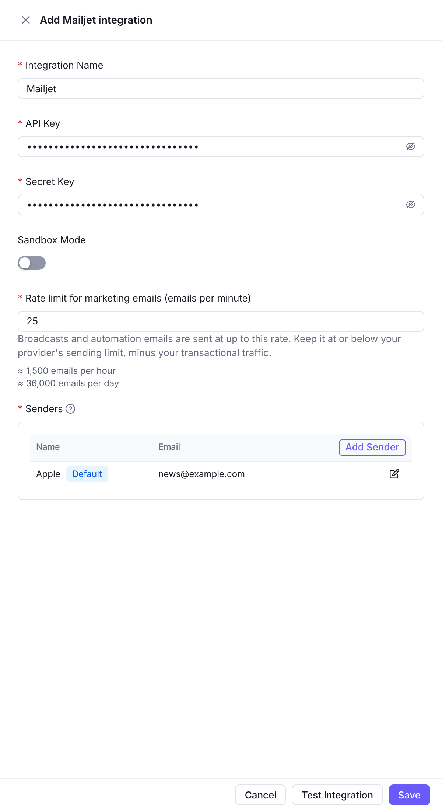
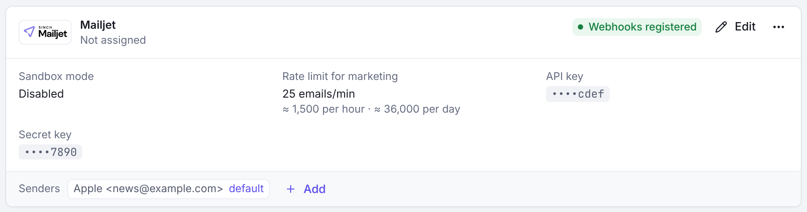

Mailjet integration allows you to use Mailjet for sending transactional emails through Notifuse.

## Configuration

Navigate to **Settings** → **Integrations**, then **Add a provider** under **Email providers** → **Mailjet**. On a workspace with no integration yet, choose **Mailjet** in the list of available integrations.

### Form Fields

| Field            | Description                | Example                            |
| ---------------- | -------------------------- | ---------------------------------- |
| **API Key**      | Mailjet public API key     | `1234567890abcdef1234567890abcdef` |
| **Secret Key**   | Mailjet private secret key | `abcdef1234567890abcdef1234567890` |
| **Sandbox Mode** | Enable sandbox mode toggle | `Disabled` (for production)        |

### Senders List

Add sender addresses that have been verified in your Mailjet account:

| Field     | Description                 | Example                    |
| --------- | --------------------------- | -------------------------- |
| **Name**  | Display name for the sender | `Marketing Team`           |
| **Email** | Sender email address        | `marketing@yourdomain.com` |

**Important**: Senders must be verified in Mailjet console before they can be used.

### Usage Types

Mailjet can only be used for transactional emails. Mailjet's API rewrites unsubscribe links, so Notifuse refuses it as the marketing provider of broadcasts:

| Option                    | Description                                       | Examples                                                    |
| ------------------------- | ------------------------------------------------- | ----------------------------------------------------------- |
| **Use for Transactional** | System-generated emails triggered by user actions | Password resets, order confirmations, account notifications |

### Webhooks

Notifuse automatically registers the following Mailjet webhooks:

| Webhook Type   | Description                     | Purpose                     |
| -------------- | ------------------------------- | --------------------------- |
| **Delivery**   | Email successfully delivered    | Track successful deliveries |
| **Bounces**    | Email bounced                   | Monitor bounces             |
| **Complaints** | Recipient filed abuse complaint | Handle abuse reports        |

These webhooks provide real-time feedback on email performance and delivery status.

## Prerequisites

Before configuring Mailjet:

1. **Mailjet Account**: Active Mailjet account
2. **Verified Senders**: Email addresses or domains verified in Mailjet console
3. **API Credentials**: Mailjet API key and secret key

## Testing

Click **Test Integration** to verify your configuration.
