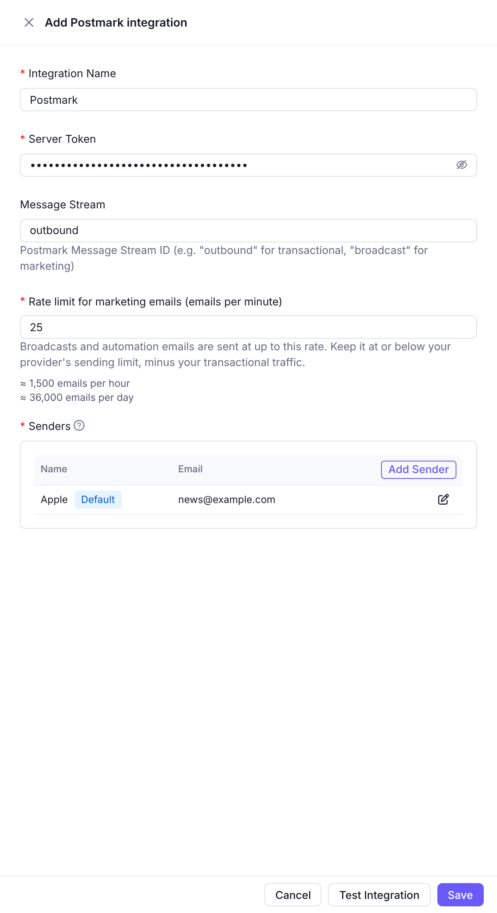
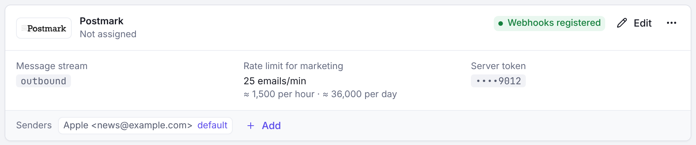

Postmark integration allows you to use Postmark for sending transactional and marketing emails through Notifuse.

## Configuration

Navigate to **Settings** → **Integrations**, then **Add a provider** under **Email providers** → **Postmark**. On a workspace with no integration yet, choose **Postmark** in the list of available integrations.

### Form Fields

| Field            | Description               | Example                                |
| ---------------- | ------------------------- | -------------------------------------- |
| **Server Token** | Postmark server API token | `12345678-1234-1234-1234-123456789012` |

### Senders List

Add sender addresses that have been verified in your Postmark account:

| Field     | Description                 | Example                  |
| --------- | --------------------------- | ------------------------ |
| **Name**  | Display name for the sender | `Support Team`           |
| **Email** | Sender email address        | `support@yourdomain.com` |

**Important**: Senders must be verified in Postmark console before they can be used.

### Usage Types

Postmark can be used for both transactional emails and broadcast campaigns:

| Option                    | Description                                       | Examples                                                    |
| ------------------------- | ------------------------------------------------- | ----------------------------------------------------------- |
| **Use for Transactional** | System-generated emails triggered by user actions | Password resets, order confirmations, account notifications |
| **Use for Broadcasts**    | Mass email campaigns and newsletters              | Marketing newsletters, product updates, promotional emails  |

### Webhooks

Notifuse automatically registers the following Postmark webhooks:

| Webhook Type   | Description                     | Purpose                     |
| -------------- | ------------------------------- | --------------------------- |
| **Delivery**   | Email successfully delivered    | Track successful deliveries |
| **Bounce**     | Email bounced                   | Monitor bounces             |
| **Complaints** | Recipient filed abuse complaint | Handle abuse reports        |

These webhooks provide real-time feedback on email performance and delivery status.

## Prerequisites

Before configuring Postmark:

1. **Postmark Account**: Active Postmark account
2. **Verified Senders**: Email addresses or domains verified in Postmark console
3. **Server Token**: Postmark server API token from your account

## Testing

Click **Test Integration** to verify your configuration.
